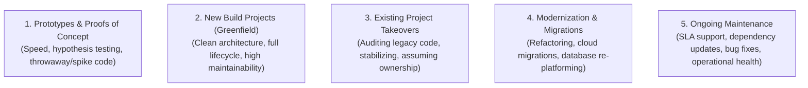

# 05. Engagement Patterns

This directory defines the proposed technical engagement patterns through which the agency delivers engineering services—accounting for the distinct constraints of prototypes, greenfield builds, legacy takeovers, modernizations, and maintenance retainers.

## Purpose

To adapt the technical delivery lifecycle and engineering standards to match the commercial realities, risk profiles, and operational expectations of different engagement archetypes without duplicating core standards.

## The 5 Engagement Patterns

## Directory Navigation

| Pattern Document | Engagement Archetype | Primary Technical Objective |
| :--- | :--- | :--- |
| [`prototypes-and-proofs-of-concept.md`](./prototypes-and-proofs-of-concept.md) | Rapid exploratory builds / POCs | Fast de-risking of hypotheses with tailored lightweight controls |
| [`new-build-projects.md`](./new-build-projects.md) | Greenfield application development | Full-lifecycle engineering from architecture to production release |
| [`existing-project-takeovers.md`](./existing-project-takeovers.md) | Inherited / abandoned codebases | Technical audit, stabilization, secrets rotation, and baseline CI |
| [`modernization-and-migrations.md`](./modernization-and-migrations.md) | Legacy system transformation | Strangler-fig refactoring, database migrations, platform shifts |
| [`ongoing-maintenance.md`](./ongoing-maintenance.md) | Operational retainers & support | SLA adherence, dependency patching, uptime, and incident response |

## Related Agency Categories

- [`../../05-sales/README.md`](../../05-sales/README.md): Scoping and packaging appropriate engagement patterns.
- [`../../11-project-delivery-and-client-service/README.md`](../../11-project-delivery-and-client-service/README.md): Client expectations and communication per pattern.
- [`../03-delivery-lifecycle/README.md`](../03-delivery-lifecycle/README.md): Shared delivery progression.

## Open Questions

- What criteria govern when a prototype codebase may be promoted to production vs. requiring a clean greenfield rebuild?
- How is technical liability framed when taking over an existing codebase with unknown pre-existing security vulnerabilities?
