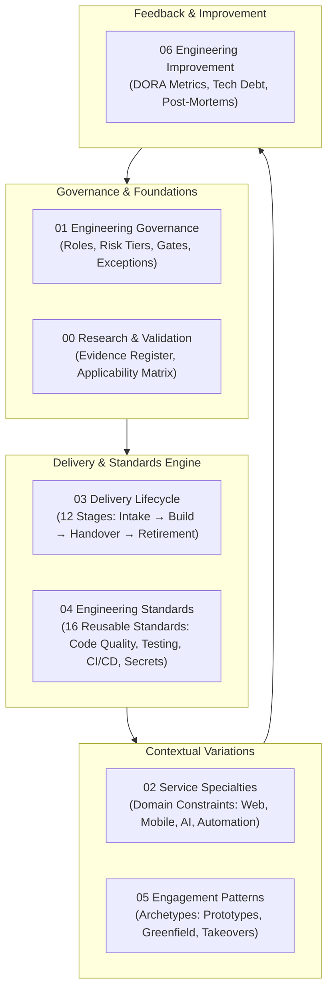

# Category 01: Development and Engineering

Welcome to the Development and Engineering knowledge base for our technology-services startup and agency.

This category establishes how the agency designs, builds, verifies, deploys, maintains, and decommissions software, applications, integrations, automation pipelines, and platform infrastructure.

---

## 1. Purpose and Scope

### Purpose
To ensure that all engineering deliverables achieve consistent architectural quality, high reliability, appropriate security, and practical maintainability while fostering rapid developer velocity and safe client handoffs.

### Scope
- Technical intake, feasibility assessment, and architecture design.
- Full delivery lifecycle execution from requirements to system retirement.
- Universal engineering standards (version control, secrets hygiene, testing, CI/CD, observability).
- Domain-specific service specialties (web, mobile, APIs, automations, AI systems, data pipelines).
- Diverse engagement patterns (prototypes, greenfield builds, legacy takeovers, modernizations, maintenance).
- Continuous engineering improvement, DORA metrics, and technical debt management.

### Out of Scope (Boundaries with Other Categories)
- **Commercial Scoping & Pricing:** Managed by [`../../05-sales/`](../05-sales/README.md). Engineering provides technical estimates and assumptions.
- **Client Project Management & Contractual Commitments:** Managed by [`../../11-project-delivery-and-client-service/`](../11-project-delivery-and-client-service/README.md). Engineering executes technical milestones and provides delivery evidence.
- **Financial Controls & Budgets:** Managed by [`../../10-finance-and-money-management/`](../10-finance-and-money-management/README.md). Engineering supplies resource inputs and adheres to approved spending thresholds.
- **Legal Compliance & Security Policies:** Managed by [`../../12-legal-security-and-risk-management/`](../12-legal-security-and-risk-management/README.md). Engineering implements technical security controls and reports gaps.
- **Documentation Standards & Tooling Governance:** Managed by [`../../13-knowledge-systems-and-automation/`](../13-knowledge-systems-and-automation/README.md). Engineering owns the technical validity of its internal content.

---

## 2. Current Development Stage

> [!IMPORTANT]
> **Stage: Architectural Scaffolding & Initial Evidence Map.**
> 
> All documents in this category represent **proposed frameworks and candidate practices**.
> - **Service specialties are unconfirmed:** No specific tech stacks or commercial services are officially approved.
> - **Walkthroughs are synthetic:** Scenario walkthroughs validate architecture; they are not production pilots.
> - **Source citations do not equal policy approval:** External standards (NIST, DORA, WCAG) provide evidence, not ratified agency rules.

---

## 3. Core Architectural Distinction

To avoid duplication and procedural bloat, this knowledge base separates 5 distinct dimensions:



1. **Service Specialties (`02-service-specialties/`):** *What* kinds of solutions we evaluate (e.g., mobile constraints, AI model risks, automation retry storms). Does not repeat general lifecycle steps.
2. **Delivery Lifecycle (`03-delivery-lifecycle/`):** *How* technical work moves through 12 stages from intake to retirement.
3. **Engineering Standards (`04-engineering-standards/`):** *Universal* technical practices (linting, secrets hygiene, testing pyramids, CI/CD pipelines) applied across all project types.
4. **Engagement Patterns (`05-engagement-patterns/`):** *Variations* in commercial delivery (throwaway prototypes vs. high-assurance greenfield builds vs. legacy takeovers).
5. **Governance and Improvement (`01-` & `06-`):** Accountability, risk tailoring, review gates, exceptions, metrics, and retrospectives.

---

## 4. Directory Navigation

```text
01-development-and-engineering/
├── README.md                           # This orientation guide
├── coverage-matrix.md                  # Comprehensive mapping of all required engineering subjects
├── development-roadmap.md              # Status and priority tracking for all engineering areas
├── open-questions.md                   # Register of unresolved technical & architectural decisions
│
├── 00-research-and-validation/         # Primary evidence (NIST, DORA, W3C), applicability matrix & validation logs
│   ├── README.md
│   ├── research-plan.md
│   ├── evidence-register.md
│   ├── candidate-practices.md
│   ├── applicability-matrix.md
│   └── validation-log.md
│
├── 01-engineering-governance/          # Roles, risk tailoring, review gates, exceptions, and ADR governance
│   ├── README.md
│   ├── roles-and-ownership.md
│   ├── project-risk-and-tailoring.md
│   ├── review-gates-and-evidence.md
│   ├── exceptions-and-escalation.md
│   └── engineering-decisions.md
│
├── 02-service-specialties/             # 8 candidate domain specialties (all unconfirmed; no prescribed stack)
│   ├── README.md
│   ├── service-catalog.md
│   ├── web-applications-and-websites.md
│   ├── mobile-applications.md
│   ├── backend-apis-and-integrations.md
│   ├── automation-and-business-systems.md
│   ├── ai-applications-and-agents.md
│   ├── data-engineering-and-analytics.md
│   ├── cloud-and-platform-engineering.md
│   └── desktop-applications.md
│
├── 03-delivery-lifecycle/              # 12-stage technical progression from intake to decommissioning
│   ├── README.md
│   ├── 01-technical-intake-and-handoff.md
│   ├── 02-discovery-and-requirements.md
│   ├── 03-existing-system-assessment.md
│   ├── 04-experience-and-solution-design.md
│   ├── 05-feasibility-estimation-and-planning.md
│   ├── 06-project-engineering-setup.md
│   ├── 07-iterative-implementation.md
│   ├── 08-verification-and-client-acceptance.md
│   ├── 09-release-readiness-and-deployment.md
│   ├── 10-handover-and-support-transition.md
│   ├── 11-operation-maintenance-and-technical-closure.md
│   └── 12-retirement-and-client-exit.md
│
├── 04-engineering-standards/           # 16 reusable technical practices (code review, secrets, testing, CI/CD)
│   ├── README.md
│   ├── architecture-and-technical-decisions.md
│   ├── ux-ui-and-accessibility.md
│   ├── code-quality-and-review.md
│   ├── source-control-and-change-integration.md
│   ├── environments-configuration-and-secrets.md
│   ├── dependencies-and-software-supply-chain.md
│   ├── api-and-integration-engineering.md
│   ├── data-databases-and-test-data.md
│   ├── security-and-privacy-engineering.md
│   ├── testing-and-quality-engineering.md
│   ├── performance-and-capacity.md
│   ├── ci-cd-and-release-engineering.md
│   ├── observability-and-operational-readiness.md
│   ├── backup-recovery-and-incident-engineering.md
│   ├── technical-documentation.md
│   └── ai-assisted-development.md
│
├── 05-engagement-patterns/             # 5 delivery variations (prototypes, greenfield, takeovers, migrations, ops)
│   ├── README.md
│   ├── prototypes-and-proofs-of-concept.md
│   ├── new-build-projects.md
│   ├── existing-project-takeovers.md
│   ├── modernization-and-migrations.md
│   └── ongoing-maintenance.md
│
└── 06-engineering-improvement/         # Continuous improvement, DORA metrics, debt management, post-mortems
    ├── README.md
    ├── delivery-and-quality-measures.md
    ├── technical-debt-management.md
    ├── retrospective-and-root-cause-learning.md
    └── improvement-backlog.md
```

---

## 5. How Research Becomes an Approved Agency Instruction

To maintain credibility and prevent operational bloat, practices progress through a strict 6-stage lifecycle:

1. **Research & Evidence:** External standards (e.g., NIST SP 800-218, DORA, WCAG 2.2) are evaluated and cited in [`00-research-and-validation/evidence-register.md`](./00-research-and-validation/evidence-register.md).
2. **Trade-off Analysis:** Candidate practices are analyzed for startup cost, complexity, and benefit in [`00-research-and-validation/candidate-practices.md`](./00-research-and-validation/candidate-practices.md).
3. **Scenario Walkthrough:** The practice is stress-tested against realistic scenarios in [`00-research-and-validation/validation-log.md`](./00-research-and-validation/validation-log.md).
4. **Founder Discussion & Decision:** Trade-offs are reviewed by leadership, and an Operating Decision Record is adopted in [`../../decisions/`](../../decisions/README.md).
5. **Drafting Standards & Playbooks:** Concrete guidelines are authored in `04-engineering-standards/` using the standard templates.
6. **Production Pilot & Refinement:** The practice is tested in live client projects, monitored via DORA metrics, and refined through blameless post-mortems.

---

## 6. Where to Start

- **Understand Subject Coverage:** Review [`coverage-matrix.md`](./coverage-matrix.md) to locate the canonical home for any technical topic.
- **Check Progress & Priorities:** Review [`development-roadmap.md`](./development-roadmap.md) to see active drafting priorities.
- **Review Open Technical Decisions:** Read [`open-questions.md`](./open-questions.md) to understand pending architectural choices.
- **Inspect Validated Evidence:** Read [`00-research-and-validation/evidence-register.md`](./00-research-and-validation/evidence-register.md) to see the primary standards grounding our work.
- **Examine Walkthrough Results:** Read [`00-research-and-validation/validation-log.md`](./00-research-and-validation/validation-log.md) to trace how projects navigate the lifecycle.
