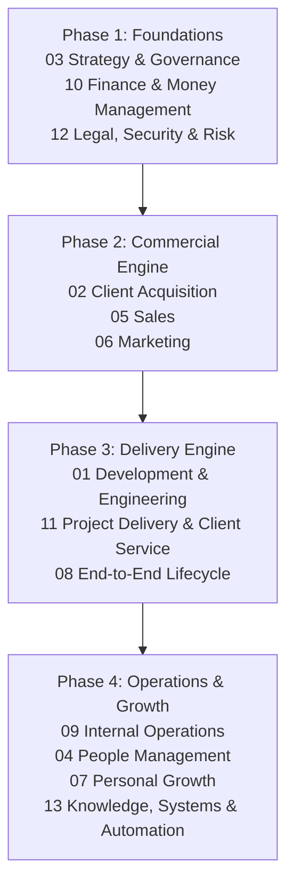

# Category Development Roadmap

This roadmap tracks the development, research, drafting, and approval status of the agency's 13 operational categories.

> [!NOTE]
> All categories are currently in the initial architecture and scaffolding phase. Dates, owners, and specific operational deadlines are deliberately left unassigned until founders formally review priorities and assign responsibilities.

---

## 1. Overall Status Overview

| Stage | Definition |
| :--- | :--- |
| **Scaffolding** | Category README, boundary definitions, and proposed candidate topics created. (Current state for all 13 categories). |
| **Needs Clarification** | Key foundational questions, business model assumptions, or trade-offs require founder alignment. |
| **Researching** | External benchmarks, literature, tools, and peer agency practices being captured in `research/`. |
| **Drafting** | Initial policies, playbooks, workflows, or checklists being written using standard templates. |
| **In Review** | Drafted documents undergoing formal founder or stakeholder review. |
| **Approved** | Binding policies or authorized playbooks formally adopted and operational. |

---

## 2. Category Development Tracker

| Category | Current Status | Needs Clarification | Research Status | Drafting Status | Approval Status | Next Action |
| :--- | :---: | :--- | :---: | :---: | :---: | :--- |
| **01. Development & Engineering** | Scaffolding | Default tech stack, code quality gates, production access controls | Not started | Scaffolding only | Proposed | Discuss core default tech stack & Definition of Done |
| **02. Client Acquisition (CA)** | Scaffolding | Ideal Customer Profile (ICP), lead qualification criteria (SQL), outreach channels | Not started | Scaffolding only | Proposed | Define target buyer persona & qualifying criteria |
| **03. Business Strategy & Governance** | Scaffolding | Core service catalog, business model, founder decision rights matrix | Not started | Scaffolding only | Proposed | Agree on founder decision rights & core service offering |
| **04. People & Relationship Management** | Scaffolding | Contractor vs employee ratio, standard pay bands, onboarding checklists | Not started | Scaffolding only | Proposed | Draft standard contractor vetting and onboarding flow |
| **05. Sales** | Scaffolding | Pricing models (fixed/retainer/T&M), minimum engagement size, discounting rules | Not started | Scaffolding only | Proposed | Formulate discovery call questions & SOW structure |
| **06. Marketing** | Scaffolding | Primary organic channels, client case study consent terms, publishing rhythm | Not started | Scaffolding only | Proposed | Establish case study consent terms & initial web copy |
| **07. Personal & Professional Growth** | Scaffolding | Practice time allocation, scenario role-play priority scripts | Not started | Scaffolding only | Proposed | Select priority role-play scenarios for client calls |
| **08. End-to-End Agency & Startup** | Scaffolding | Stage-gate sign-offs between sales, delivery, and invoicing | Not started | Scaffolding only | Proposed | Map detailed stage gates for Client Engagement Journey |
| **09. Internal Operations & Work Management** | Scaffolding | Task tracking tool choice, weekly meeting cadence, async comms rules | Not started | Scaffolding only | Proposed | Select project management tool & weekly sync rhythm |
| **10. Finance & Money Management** | Scaffolding | Banking setup, founder spending limits, invoice payment terms, cash buffer target | Not started | Scaffolding only | Proposed | Set founder expense approval limits & payment terms |
| **11. Project Delivery & Client Service** | Scaffolding | Client communication channels, Scope Change Request thresholds, warranty window | Not started | Scaffolding only | Proposed | Draft Change Request workflow & client kickoff agenda |
| **12. Legal, Security, & Risk Management** | Scaffolding | External legal counsel, choice of jurisdiction, password manager & MFA rules | Not started | Scaffolding only | Proposed | Draft baseline Secrets Policy & engage legal for MSA |
| **13. Knowledge, Systems, & Automation** | Scaffolding | Notion vs Markdown source-of-truth, AI tool data-sharing policy, doc audit schedule | Not started | Scaffolding only | Proposed | Formulate Notion vs Markdown architecture decision (ODR) |

---

## 3. Recommended Phased Development Sequence

While all 13 categories exist simultaneously as areas of responsibility, drafting should proceed in logical foundational blocks:

- **Phase 1 (Foundations):** Resolve Strategy (03) to know what we sell; Finance (10) to know how money is guarded; Legal (12) to protect the business.
- **Phase 2 (Commercial Engine):** Build Client Acquisition (02), Sales (05), and Marketing (06) to generate predictable revenue.
- **Phase 3 (Delivery Engine):** Formalize Engineering (01), Project Delivery (11), and End-to-End (08) to deliver reliably on sales promises.
- **Phase 4 (Operations & Growth):** Scale Internal Operations (09), People (04), Growth (07), and Knowledge/Automation (13) to sustain execution.
