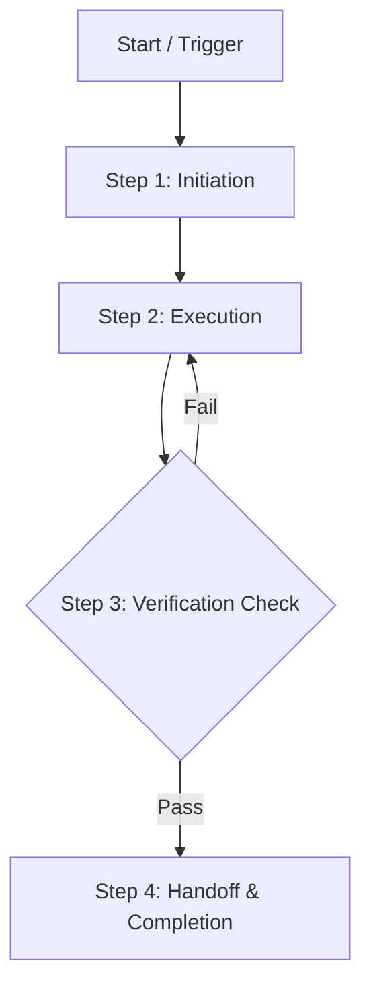

# [Workflow Name]

> [!NOTE]
> A Workflow defines a repeatable, step-by-step operational sequence of actions, roles, handoffs, inputs, and outputs.

## 1. Purpose
State what operational process this workflow executes and what standard it achieves.

## 2. When to Use
- **Trigger:** Event or condition that starts this workflow (e.g., contract signed, bug reported, sprint planning).
- **Frequency:** [On demand / Daily / Weekly / Monthly]

## 3. Inputs and Prerequisites
Items that must be present before Step 1 begins:
- Input 1 (e.g., approved discovery brief)
- Input 2 (e.g., access credentials)

## 4. Roles and Responsibilities
| Role | Workflow Responsibility |
| :--- | :--- |
| **Workflow Owner** | Oversees execution from initiation to sign-off |
| **Contributor(s)** | Completes specific tasks within the step sequence |
| **Receiver** | Accepts the handoff upon completion |

## 5. Step-by-Step Procedure and Handoffs

### Step 1: [Step Name]
- **Action:** Detailed description of what must be done.
- **Owner:** [Role]
- **Input:** [Artifact / Data]
- **Output:** [Artifact / State change]

### Step 2: [Step Name]
- **Action:** Detailed description of execution.
- **Owner:** [Role]
- **Input:** [Output of Step 1]
- **Output:** [Intermediate Deliverable]

### Step 3: [Handoff / Verification Step]
- **Action:** How the output is reviewed and handed off to the next role or downstream category.
- **Sender Role:** [Role]
- **Receiver Role:** [Role]
- **Verification:** Reference to verification checklist or criteria.

### Step 4: [Finalization & Logging]
- **Action:** Final notifications, updating tracker, filing records.
- **Owner:** [Role]

## 6. Outputs and Deliverables
- Final output 1
- Final output 2

## 7. Completion Criteria
List unambiguous conditions required to mark this workflow complete:
- [ ] Condition 1 met
- [ ] Condition 2 verified
- [ ] Downstream recipient confirmed handoff

## 8. Exceptions
How to handle edge cases or flow interruptions (e.g., missing input, uncooperative stakeholder).

## 9. Escalation Path
Who to contact if the workflow is blocked or exceeds expected turnaround time.
- **Escalate to:** [Role]
- **Conditions:** [e.g., Blocker unresolved after 24 hours]

## 10. Related Policies and Playbooks
- **Governing Policy:** `[Policy Name](<relative-path-to-policy.md>)`
- **Guidance Playbook:** `[Playbook Name](<relative-path-to-playbook.md>)`
- **Execution Checklist:** `[Checklist Name](<relative-path-to-checklist.md>)`

## 11. Measures of Effectiveness
- Cycle time (average elapsed time from trigger to completion)
- Handoff rework rate (percentage of handoffs rejected by receiver)

## 12. References and Source Notes
- `[Research Note](<../../research/rn-category-topic.md>)`

## 13. Change History
| Version | Date | Author / Owner | Change Summary |
| :--- | :--- | :--- | :--- |
| 0.1 | [YYYY-MM-DD] | [unassigned] | Initial proposed workflow draft |
